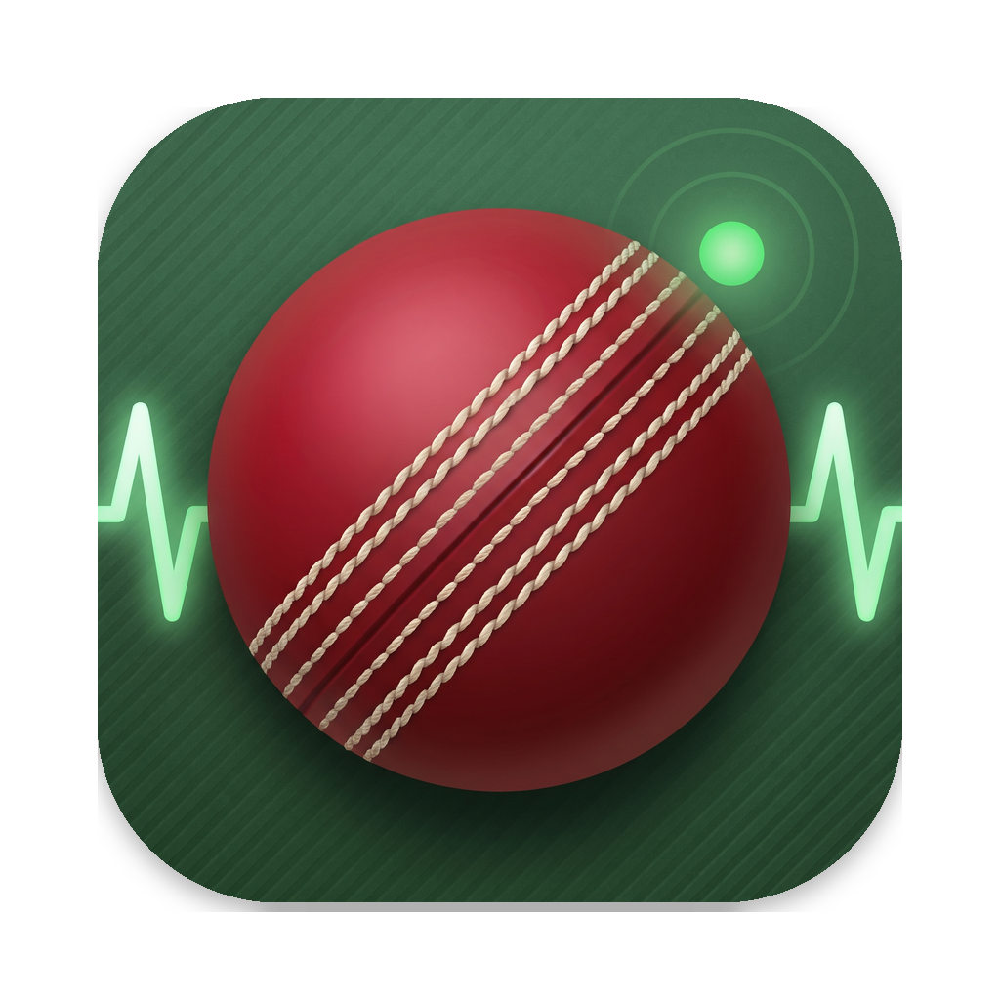

# cricinfo-feed

Small macOS app. Floating window, always on top, shows live scores for the cricket matches you pick.

## Build and run

```sh
./scripts/build-app.sh
open build/CricketFeed.app
```

## Install

```sh
./scripts/install.sh
```

Builds the app and copies it into `/Applications`. Run it again to update. If the app is running, quit it from the menu bar icon first, then reopen it.

The icon is `assets/icon-1024.png`. The build turns it into `AppIcon.icns`.

## Use

- Press `+` to pick matches. Press the tick when done.
- Drag the window anywhere to move it.
- Right-click a match to open it on Cricinfo or stop watching it.
- Menu bar icon: show/hide window, quit. There's no Dock icon.
- Scores refresh every 10 seconds.

## Data source

Uses ESPN's unofficial score feed (ESPN owns Cricinfo):
`https://site.api.espn.com/apis/site/v2/sports/cricket/scorepanel`

No key or login needed. It isn't documented, so it may change or stop working without notice. Match IDs match Cricinfo's.
